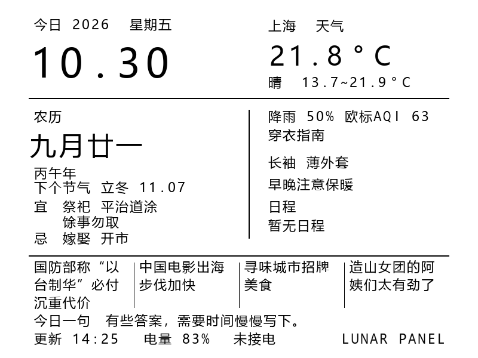
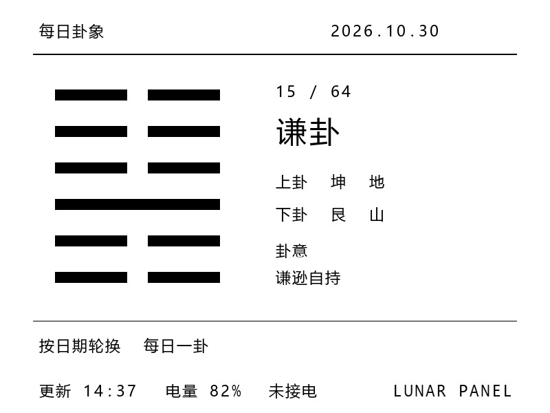

# Kindle 农历信息面板

将已越狱的 Kindle 用作横屏电子墨水信息面板，显示日期、农历、传统黄历宜忌、上海天气、穿衣建议和多来源热点。面板在 Kindle 上运行，不需要电脑持续开启。





## 功能

- 公历、星期、农历、干支年和下个节气：农历数据预先生成，离线可用，覆盖 **2025 年至 2040 年**。
- 宜忌：根据 `lunar-javascript` 生成，每项最多显示四条。不同黄历资料的结果可能不同，仅供传统文化参考。
- 天气：通过 Open-Meteo 查询上海当前气温、天气、今日最低和最高气温、今日最大降雨概率及欧洲空气质量指数（EAQI）。联网失败时保留上次结果并标注“缓存”，无缓存时显示暂无天气。
- 穿衣指南：按当前气温分档生成，气温不可用时显示暂无建议。
- 热点：日常页横向显示最多四条抖音热搜词；热点简报页显示微博、知乎和 IT之家的内容。长标题以省略号截断，各来源独立缓存，失效时标注“缓存”。IT之家为最新科技资讯，并非热搜排名。
- 四种页面：日常页、热点简报页、每日卦象页和设备页。默认自动在前三页之间约每 5 分钟切换，设备页可手动选择。
- 每日卦象：按设备本地日期、六十四卦的传统顺序离线轮换，显示六爻、上下卦和简要卦意；这是日期轮换展示，并非起卦或预测。
- 日程：从 `LunarPanel/events.txt` 读取本地日程，没有配置时显示“暂无日程”。这不是日历云同步功能。
- 今日一句：日常页每天从本地句库中按日期轮换一句，无需联网。
- 底栏状态：显示最近更新时间、电量和当前供电或限充状态。
- 刷新：联网数据约每 30 分钟获取一次，显示中的热点约每 5 分钟切换一次。这些定时依赖设备保持运行。
- 横屏方向：支持充电接口朝左或朝右，KUAL 中切换并记住选择。
- 防锁屏：面板运行时持续阻止自动屏保，拔掉充电器后仍保持显示；停止面板时恢复系统默认屏保。电池模式下会明显增加耗电。
- 充电限制：可在 KUAL 手动启动独立控制器，电量达到或超过 80% 时停充，降到或低于 40% 时续充；40% 至 80% 之间保持充电周期状态，插拔电源也不会重置。控制器启动时默认等待至 40%。适用于已确认具有 `bd7181x_bat/charging` 接口的设备。

**尚未实现**：开机自动启动和休眠后定时唤醒。充电控制依赖设备持续运行，不能替代设备自身的充电与电池保护机制。

## 已验证设备

| 项目 | 当前设备 |
| --- | --- |
| 型号 | Kindle 基础版第八代，Kindle Basic 2 / Eanab |
| 固件 | `5.16.2.1.1` |
| 屏幕 | 物理帧缓冲区 `600×800`，面板内容横屏 `800×600` |
| 启动方式 | 越狱后通过 KUAL |
| 显示工具 | 设备上的 FBInk `1.25.0` |

本项目依赖 Kindle 的 Linux 路径、FBInk、Lua 和电源管理接口。其他型号、分辨率或固件可能需要适配，不能保证直接运行。

## 复刻准备

1. 一台**已经完成越狱并安装 KUAL** 的 Kindle。越狱方式与型号和固件密切相关，请先阅读 [KindleModding 越狱指南](https://kindlemodding.org/jailbreaking/) 并用其向导核对设备；不要套用其他型号的教程。
2. 一根支持数据传输的 USB 线，以及连接互联网的 Wi-Fi。首次测试建议保持有线连接和充足电量。
3. Kindle 上具备 `/usr/bin/lua`、`/usr/bin/curl` 和支持 PNG/PGM 图片的 `/mnt/us/libkh/bin/fbink`。当前设备的越狱环境已提供这些工具；**安装 KUAL 本身不保证它们存在**。
4. Kindle 时间和时区正确。农历日期取自设备本地时间，时间不准会影响日期和缓存判断。

可以先复制本扩展并在 KUAL 中运行 **Lunar Panel → Run diagnostics**。重新接入电脑后查看 `extensions/LunarPanel/diagnostics.txt`，其中会列出 FBInk 屏幕信息、支持的功能和部分命令路径。如果缺少 FBInk，需要先从可信的 Kindle 社区渠道取得与你的型号和固件兼容的版本，并确认其具有图片显示功能。

## 安装面板

1. 通过 USB 将 Kindle 连接电脑，打开其存储盘。下面以 Windows 的 `F:` 为例，实际盘符以你的电脑为准。
2. 将本项目中的整个 [`LunarPanel/`](LunarPanel/) 目录复制到 Kindle 的 `extensions` 目录。若同名目录已存在，先备份并检查内容，避免覆盖自己的文件。

   ```text
   Kindle 存储盘/
   └── extensions/
       └── LunarPanel/
           ├── config.xml
           ├── menu.json
           ├── panel.sh
           ├── panel.lua
           ├── news.lua
           ├── glyphs.bin
           ├── glyphs.txt
           └── lunar-data.txt
   ```

   目录中还包含 JSON 解析器、穿衣建议、方向切换及诊断脚本；复制**整个目录**，不要只复制上面列出的文件。不要多套一层 `LunarPanel` 文件夹。

3. 在电脑上安全弹出 Kindle，然后拔掉数据线。确认 Kindle 已连接 Wi-Fi。
4. 打开 KUAL，选择 **Lunar Panel → Start panel**。初次联网请求可能需要几十秒，等待显示完成。
5. 按摆放方向选择 **USB on right** 或 **USB on left**。选择后会重新绘制画面，并保存方向。
6. 想停止后台刷新时，返回 KUAL，选择 **Lunar Panel → Stop panel**。普通阅读和系统界面仍通过 Kindle 原有操作进入。

页面模式在 KUAL 的 **Lunar Panel** 菜单中选择：**Pages: automatic** 自动轮换，**Page: daily** 固定日常页，**Page: news** 固定热点页，**Page: hexagram** 固定卦象页，**Page: device** 固定设备页。选择会保存并立即绘制；要持续刷新，还需运行 **Start panel**。自动切换取决于面板进程运行和 Kindle 保持唤醒。

如果系统界面或状态栏重新绘制到面板上，画面可能被覆盖；下一次面板刷新时会重新绘制。改变方向不会旋转 Kindle 的原生系统界面。

## 充电限制

详细实现、安装和更新步骤见 [充电限制说明](CHARGE_CONTROL.md)。

本功能参考用户提供的 `5.16.2.1.1` Kindle 源码包中的 `bd7181x` 驱动，并结合 Kindle Basic 2 实机测试实现；源码包下载来源与运行中内核的逐字对应尚未独立验证。其他型号不要假设同名接口具有相同含义。

1. 将 Kindle 接到 USB 充电器并打开面板。
2. 在 KUAL 选择 **Lunar Panel → Start charge limit 40-80**。控制器约每 10 秒读取一次电量及外部供电状态，插入电源后可能有短暂的充电响应延迟。
3. 需要关闭限充并恢复充电时，选择 **Stop charge limit and enable charging**。停止面板显示与停止限充是两个独立操作。
4. 查看 `extensions/LunarPanel/charge.log`，可核对控制器启停与充电开关操作。

已在实机高电量条件下验证停充、手动停止恢复，以及控制进程被强制终止后看护进程恢复充电；40% 以下的完整放电和续充周期尚未实机验证。看护进程和定时检查都依赖系统运行，不能保证休眠、断电、强制重启或系统故障后立即恢复；控制器也不会开机自动启动。重新启动后请检查充电状态，需要时先在 KUAL 选择 **Stop charge limit and enable charging** 再重新启动控制器。

驱动的 `charging` 读数同时受外部电源连接状态影响：未接电时为 `0`，不能单独证明充电开关被禁用。电量读数、充电状态和电流变化也可能存在延迟。

## 文件与实现

| 路径 | 作用 |
| --- | --- |
| `LunarPanel/panel.sh` | KUAL 启动入口、联网获取、缓存、刷新循环及面板运行时防锁屏 |
| `LunarPanel/panel.lua` | 绘制 `800×600` 面板并旋转成设备可显示的 `600×800` PGM |
| `LunarPanel/news.lua`、`news-check.lua` | 校验和解析各热榜 JSON、选择标题及标记缓存 |
| `LunarPanel/weather-fetch.lua` | 校验 Open-Meteo 天气和空气质量数据，并写入本地缓存 |
| `LunarPanel/views.lua`、`mode.sh` | 热点页、卦象页、设备页及页面模式切换 |
| `LunarPanel/hexagrams.lua` | 六十四卦的上下卦、爻象及按日期轮换 |
| `LunarPanel/events.lua` | 读取本地日程文本 |
| `LunarPanel/quotes.lua`、`quotes.txt` | 按日期选择本地句子及可编辑句库 |
| `LunarPanel/json.lua` | 第三方 JSON 解析器，文件头包含 MIT 许可 |
| `LunarPanel/clothing.lua` | 根据当前温度生成穿衣建议 |
| `LunarPanel/charge-control.sh` | 可选的 40% / 80% 限充控制和独立看护进程 |
| `LunarPanel/glyphs.bin`、`glyphs.txt`、`glyphs-large.bin`、`glyphs-large.txt` | 灰度字库及大字号字形索引 |
| `LunarPanel/lunar-data.txt` | 本地日期、干支年及每日宜忌 |
| `generate-data.js` | 使用 Node.js 和 `lunar-javascript` 生成日期、宜忌和节气表 |
| `build-font.py` | 使用 Python Pillow 生成位图字库 |

面板首先在 Lua 内存中绘制灰度像素，再生成 PGM 文件，最后调用 Kindle 的 FBInk 输出到电子墨水屏。热榜通过第三方聚合接口获取，分别缓存为 `hot-*.json`；各来源的缓存时间记录为 `hot-*.json.time`。部分聚合接口不提供榜单生成时间，因此缓存新鲜度按**本机获取时间**判断，不代表原始榜单一定刚更新。

热榜和天气标题来自外部服务，服务可能调整接口、限流或停止提供数据。设备请求时，其公网 IP 会暴露给服务提供方。

## 修改配置

### 本地日程

在 Kindle 的 `extensions/LunarPanel/events.txt` 中用 UTF-8 添加日程，每行一条，日期使用设备本地时区：

```text
2026-11-01 09:30|项目会议
2026-11-01 18:00|取快递
```

日常页最多显示当天的两条日程，按时间排序；其他日期和格式不正确的行会被跳过。文件不需要存在，缺失时显示“暂无日程”。本项目不包含 Google Calendar、CalDAV 或 ICS 同步；日程应通过 USB 或已配置的 SSH 自行更新。

### 今日一句

编辑 `LunarPanel/quotes.txt`，每行写一句，空行和以 `#` 开头的行会被忽略。每日按设备本地日期顺序轮换，句库为空或不存在时显示“暂无内容”；过长的句子会以省略号截断。

### 城市

当前城市固定为上海，不再通过公网 IP 自动定位。更换城市时需同时检查：

1. `LunarPanel/panel.sh` 中天气和空气质量请求的 `latitude`、`longitude` 和 `timezone`。
2. `LunarPanel/weather-fetch.lua` 中写入缓存的 `Shanghai` 标识，以及 `LunarPanel/panel.lua` 中的同名校验和“上海 天气”显示文字。
3. 如果新增的中文字符不在字库内，需要重新生成字库。

变更地点后先确认坐标、时区和返回数据，再修改相关字段。空气质量使用的是欧洲 AQI，不能直接视为中国 AQI。不要移除 HTTPS 证书校验来绕过连接问题。

### 新闻来源和刷新频率

- 来源地址在 `LunarPanel/panel.sh` 的 `fetch_news()` 中；显示名称、缓存文件名和轮播选取在 `LunarPanel/news.lua` 的 `news.rows()` 中。新增来源需同时确认其 JSON 结构可被 `news.load()` 解析。
- `panel.sh` 当前每次循环等待 30 分钟，每隔 5 分钟重新绘制；`news.lua` 用 300 秒选择下一条。调整频率时需要同步修改两处。
- 调整完成后通过 KUAL 先 **Stop panel**，再 **Start panel**。

### 重新生成农历和字库

项目已包含可直接使用的数据和字库，一般无需重新生成。需要调整日期范围或显示字符时：

1. 安装 Node.js、Python 3 和 Pillow。在项目目录执行 `npm install` 和 `python -m pip install Pillow`。
2. 修改 `generate-data.js` 中的日期范围。当前脚本使用 Node.js 的中文农历 `Intl` 数据与 `lunar-javascript` 生成日期和宜忌。
3. 依次执行：

   ```powershell
   node generate-data.js LunarPanel/lunar-data.txt
   python build-font.py LunarPanel
   ```

4. 将更新后的 `lunar-data.txt`、`glyphs.txt`、`glyphs.bin`、`glyphs-large.txt` 和 `glyphs-large.bin` 一起复制到 Kindle 的扩展目录，再重启面板。

字库脚本默认使用 Windows 的 `C:/Windows/Fonts/msyh.ttc`。其他系统需改为本机可用的中文字体路径；复制、使用或分发生成的字库时请自行确认相应字体许可。

## Wi-Fi 远程维护

Wi-Fi SSH 是**可选功能**，不影响面板联网获取数据。当前实机额外安装了 [USBNetwork](https://www.mobileread.com/forums/showthread.php?t=186645)，并通过独立 SSH 密钥进行局域网登录。`LunarPanel/` 中的 `Prepare SSH host key` 仅生成主机密钥，**不会安装或配置 SSH 服务**。

在自己的设备上复刻时，先参考 USBNetwork 文档完成安装，配置自己的客户端公钥、设备独立主机密钥和认证方式，再在可信局域网内测试。不要复制本项目使用过的私钥或把 SSH 端口暴露到公网。确认连接可靠前，保留 USB 存储访问方式。

SSH 连接建立后，可以读取日志或使用安全文件传输更新扩展。修改运行代码后，停止并重新启动面板使后台脚本生效。

## 排错

| 现象 | 检查方法 |
| --- | --- |
| KUAL 中没有 Lunar Panel | 检查目录是否为 `extensions/LunarPanel/`，且 `config.xml` 和 `menu.json` 在该目录下；重新打开 KUAL。 |
| 启动后没有面板 | 运行 **Run diagnostics**；检查 Lua、FBInk 路径和图片支持。查看 `extensions/LunarPanel/panel.log`。 |
| 中文显示问号 | 确保普通和大字号字库及索引是同一次生成的文件；新增字符后重新生成并一起复制。 |
| 农历显示暂无数据或日期不对 | 检查 Kindle 的日期、时区，以及 `lunar-data.txt` 是否覆盖当前日期。 |
| 天气或热点暂无数据 | 确认 Wi-Fi 已连接；运行 **Check network**，查看 `network.txt` 和 `panel.log` 中的 DNS、TLS 或 HTTP 错误。部分服务可能返回 `403` 或限流。 |
| 热点显示“缓存” | 对应来源最近一次请求失败，或本地记录的获取时间超过两小时；其他来源仍可独立更新。 |
| 一段时间后不再刷新 | 检查设备是否休眠、是否仍在运行面板，以及 `panel.log` 的刷新记录。当前没有实现休眠定时唤醒。 |
| Kindle 重新启动后面板未出现 | 当前不支持开机自启；打开 KUAL 后重新选择 **Start panel**。 |
| 限充停止后仍未充电 | 接上充电器，运行 **Stop charge limit and enable charging**，等待状态更新；检查 `charge.log`，并确认电池和充电器状态。 |

## 数据与工具来源

- [lunar-javascript](https://github.com/6tail/lunar-javascript)：本地农历与宜忌数据生成。
- [FBInk](https://github.com/NiLuJe/FBInk)：Kindle 电子墨水屏显示工具。
- [json.lua](https://github.com/rxi/json.lua)：Lua JSON 解析器，MIT 许可。
- [Open-Meteo](https://open-meteo.com/)：天气预报及欧洲空气质量指数。
- [XXAPI](https://v2.xxapi.cn/)：微博和抖音热点聚合。
- [60s](https://github.com/vikiboss/60s)：知乎热榜及 IT之家资讯聚合。
